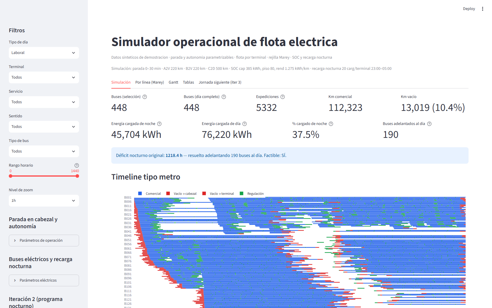
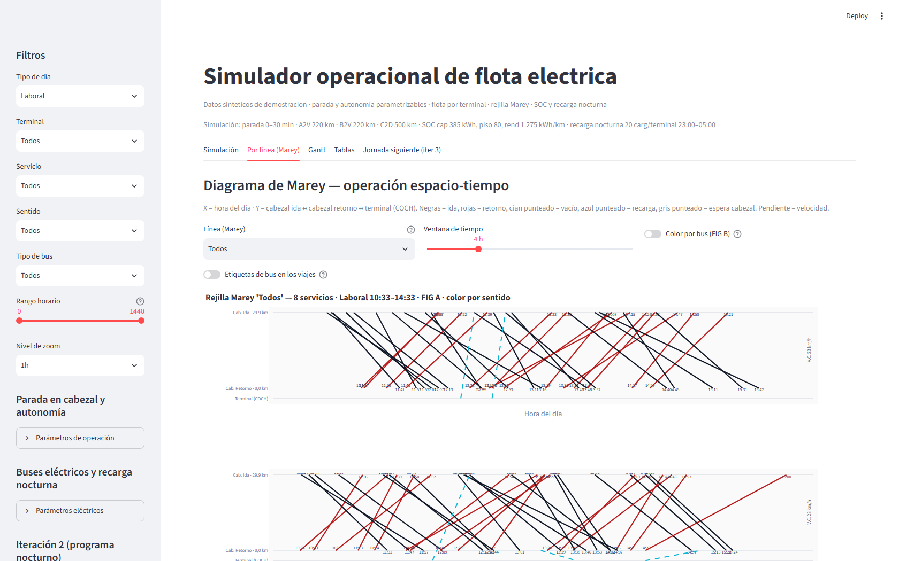
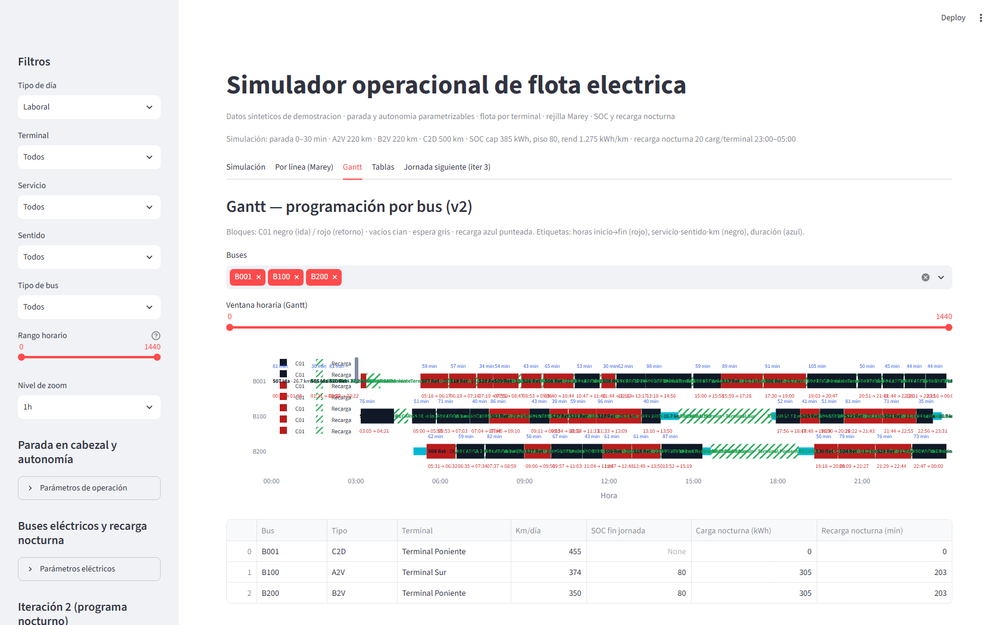
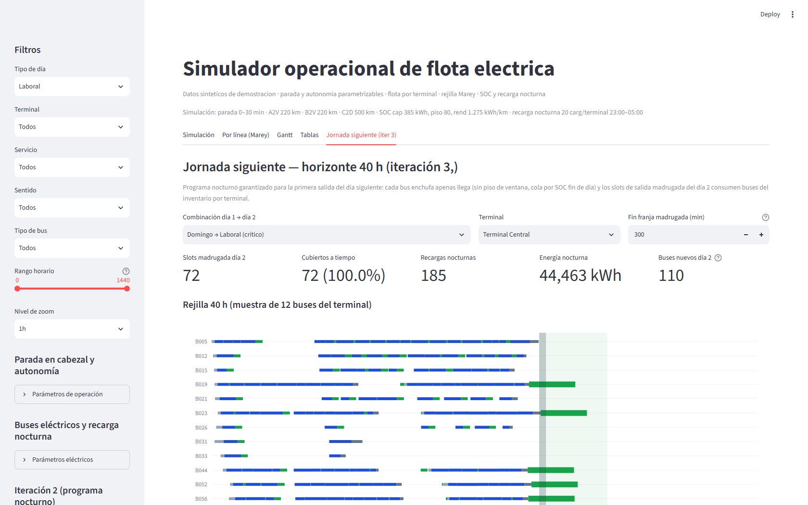

# Simulador operacional de flota de buses eléctricos

Simulador que reconstruye la operación diaria de una flota de buses eléctricos a partir de una
programación de servicios, y responde una pregunta concreta de ingeniería: **¿alcanza la
infraestructura de carga para operar la programación completa, y cuánta energía hace falta cargar
de noche?**

Desarrollo propio (proyecto personal, autodidacta).

## El problema

Al incorporar buses eléctricos a una flota, la programación de servicios ya no depende solo de
buses y conductores: ahora depende de la energía. Cada bus tiene una batería finita, un consumo por
kilómetro y un margen de seguridad que no puede traspasar. Si un bus no alcanza, hay que devolverlo
al terminal a cargar, y eso consume tiempo y ocupa un cargador. De noche, además, **todos** los
buses deben quedar cargados para el día siguiente, y la cantidad de cargadores por terminal puede
no alcanzar para hacerlo dentro de la ventana nocturna.

Este simulador modela esas restricciones y entrega los indicadores para decidir: cuántos
cargadores se necesitan, cuánta energía se consume de día y de noche, y qué buses no alcanzan a
cerrar el ciclo.

## Qué hace

1. **Simula el día completo**: asigna expediciones a buses respetando autonomía y tiempos de
   parada. Si ningún bus disponible tiene autonomía suficiente, un bus vuelve al terminal, recarga
   y reingresa (reciclaje).
2. **Modela el estado de carga (SOC)**: sigue la energía de cada bus evento por evento, aplicando
   el consumo por kilómetro y el piso de seguridad.
3. **Programa la recarga nocturna**: calcula cuánta energía falta para dejar la flota al 100 por
   ciento, la distribuye entre los cargadores disponibles por terminal (cola FIFO) dentro de la
   ventana nocturna, y detecta si la ventana no alcanza.
4. **Resuelve el déficit**: si la noche no alcanza, adelanta carga al día anterior (extiende la
   última recarga diurna) en los buses con mayor demanda, priorizando por impacto.
5. **Verifica la jornada siguiente**: con horizonte extendido, comprueba que cada bus tenga carga
   suficiente para su primera salida del día siguiente y asigna los buses por inventario de SOC.

## Interfaz

La aplicación tiene cinco vistas:

- **Simulación**: tablero de indicadores (buses, expediciones, kilómetros comerciales y vacíos,
  energía diurna y nocturna) y línea de tiempo por bus.
- **Por línea**: rejilla tipo Marey con un servicio por fila y diagrama por línea, con color por
  sentido o por bus, y distingue viaje comercial, vacío, espera en cabezal y recarga.
- **Gantt**: bloques por bus con etiquetas y tabla de SOC, más el programa de recarga nocturna.
- **Tablas**: detalle de bus estilo planilla de programación y exportación a CSV.
- **Carga nocturna**: parámetros de la iteración de recarga y verificación de la jornada siguiente.

Todos los parámetros son ajustables en vivo desde la barra lateral: autonomía por tipología de bus,
tiempo de parada en cabezal, SOC máximo, piso de seguridad, rendimiento (kWh/km), potencia del
cargador, cantidad de cargadores por terminal y ventana nocturna.

## Capturas

Vista de simulación: indicadores del día y línea de tiempo por bus.



Rejilla tipo Marey, un servicio por fila.



Diagrama de Gantt por bus, con estado de carga y programa de recarga nocturna.



Detalle de la jornada siguiente con horizonte extendido.



Las capturas corresponden a la aplicación ejecutándose con los datos sintéticos incluidos en el
repositorio.

## Arquitectura

```
motor_autonomia.py            Motor de simulacion (logica pura, sin interfaz)
app.py                        Aplicacion Streamlit (visualizacion e interaccion)
generar_datos_sinteticos.py   Generador del escenario de demostracion
data_sintetica/               Datos sinteticos generados (no hay datos reales)
```

El motor es independiente de la interfaz: `motor.simular(tipo_dia, ...)` devuelve los eventos por
bus y los indicadores, y puede usarse desde consola o desde cualquier front-end.

### Modelo de energía

- Capacidad de batería y piso de seguridad configurables (por defecto, 385 kWh y 80 kWh de piso).
- Rendimiento configurable (por defecto, 1,275 kWh por kilómetro).
- Una vuelta es factible si al llegar al terminal el SOC sigue por sobre el piso.
- La espera por recarga depende del tipo de bus: para eléctricos es el tiempo de cargar lo
  consumido, con un mínimo; para diésel es un tiempo fijo de permanencia en terminal.

## Datos sintéticos

**El repositorio no contiene ningún dato operacional ni contractual real.** Para poder publicar y
compartir el simulador, los datos de entrada se generan sintéticamente:

```bash
python generar_datos_sinteticos.py
```

El generador crea un escenario ficticio con cinco terminales, treinta servicios, tres tipos de día
(laboral, sábado y domingo) y una programación completa de expediciones con la misma estructura que
consume el simulador. Terminales, códigos de servicio y códigos de parada son inventados.

## Stack

Python 3.11, Streamlit, Plotly, pandas y NumPy.

## Instalación y uso

```bash
pip install -r requirements.txt
python generar_datos_sinteticos.py
streamlit run app.py
```

## Estructura de los datos de entrada

| Archivo | Contenido |
|---|---|
| `modelo_un16.parquet` | Segmentos de cada expedición (servicio, sentido, tipo de día, hora de inicio, tipología, kilómetros y tiempo por tramo) |
| `vacios_un16.parquet` | Kilómetros y tiempos de vacío por servicio (ida al cabezal y regreso al terminal) |
| `resumen_sim.json` | Indicadores agregados por tipo de día |
| `terminales.json` | Coordenadas de cada terminal |
| `config_terminales.json` | Servicios asignados a cada terminal |

## Licencia

MIT. Ver `LICENSE`.
